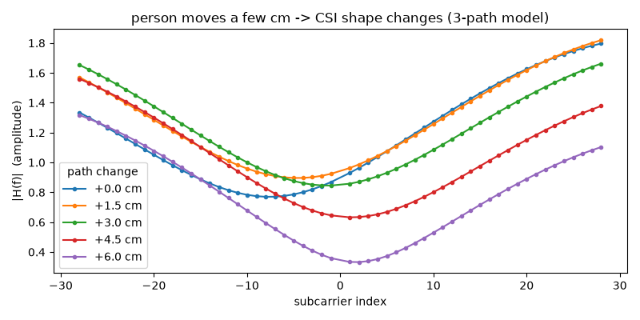

# 1. CSI とは — なぜ Wi-Fi で人の動きが分かるのか

[目次](README.md) ・ 前: [0. パソコンの基本](00_pc_basics.md) ・ 次: [2. M5Stack Basic をつなぐ](02_connect_boards.md)

この章のゴール: **「CSI は、周波数ごとの電波の届き方の記録で、人が動くとその形が変わる」**と自分の言葉で説明できること。
そして、それを表す式 H(f) と、このキットのどのコードがそれを計算しているかが分かること。

---

## 1-1. 電波は「部屋に響く音」

🌱 **ファーストタッチ**

スマホで通知音を鳴らすと、音は部屋じゅうに広がり、壁や家具に当たって響きます。
お風呂場で話すと声がよく響き、カーテンの多い部屋では響きにくい。**部屋によって「響き方」が違う**のは経験があると思います。

Wi-Fi の電波も、目に見えない・耳に聞こえないだけで、同じように部屋に広がり、壁・床・机・**人の体**に当たって跳ね返ります。

🌿 **しくみ**

- 電波は、電気と磁気の揺れが空間を伝わっていく**波**です。音（空気の揺れ）とは別物ですが、「広がる・跳ね返る・重なる」という性質は似ています
- このキットの電波は 2.4 GHz 帯（チャンネル 11 = 2462 MHz）。1 秒に約 24.6 億回揺れる波です
- 送信機から受信機へは、まっすぐ届く道だけでなく、壁や人で跳ね返った**何本もの道**を通った電波が、少しずつ遅れて重なって届きます。これを**マルチパス**（多くの道）と言います

> たとえが当てはまらない所: 音は空気が無いと伝わりませんが、電波は真空でも伝わります。
> また、2.4 GHz の電波は、薄い壁なら一部が通り抜けます（だから壁の向こうの動きも映りうる。1-6 で扱います）。

🌳 **もう一段** — 「数 cm で変わる」は、どこから来るの？

> この節は、**今は分からなくても先へ進んでかまいません**。 中学・高校の数学（三角関数）を少し使います。

**まず、たとえで全体を見ます。** 波は、**くるくる回る時計の針**だと思ってください。

- 針は 1 秒に約 24.6 億回まわる（これが周波数 2462 MHz）
- 針が 1 回まわる間に、電波は約 **12 cm** 進む（これが**波長**）
- だから、道が 12 cm 長いと、受信機に着いたとき針は**ちょうど 1 回転ぶん遅れている**。6 cm 長いと、半回転ぶん遅れている

**次に、自分で計算して確かめます。** 波長は「1 秒に進む距離 ÷ 1 秒にまわる回数」です。ターミナルで計算できます。

```sh
uv run python -c "print(299792458 / 2.462e9)"
```

`0.1217…`（約 0.122 m = 12.2 cm）と出れば正解です。`299792458` は光の速さ [m/s]、`2.462e9` は 2.462 × 10⁹ [Hz]（ch11）です。

**最後に、式で書きます。** 針の動きを式にすると、

  s(t) = A · cos(2π f t − φ)

- A: 針の長さ ＝ **振幅**（波の大きさ）
- f: 1 秒にまわる回数 ＝ **周波数**
- φ: 針の遅れ（角度）＝ **位相**

道の長さが d だけ長いと、遅れの角度は

  φ = 2π · d / λ　　（λ が波長。d が λ と同じなら 2π ＝ ちょうど 1 回転）

**分かったこと**

- 道が 12 cm 変わると針は 1 回転、6 cm なら半回転。**人が数 cm 動くだけで、その人で跳ね返る波の「針の向き」は大きく変わる**

**今は分からなくてよい所:** cos の式の形そのもの、2π が「1 回転」を表す理由（ラジアンという角度の単位）。
気になったら「AI に聞いてみよう」の聞き方で聞いてみてください。

---

## 1-2. スマホのアンテナ表示は「全体の強さ」だけ

🌱 **ファーストタッチ**

スマホの画面の右上にある、Wi-Fi の扇形や電波の棒の本数。あれは「電波がどれくらい強く届いているか」を**1 つの値**で表しています。
これを **RSSI**（受信信号の強さ）と言います。

RSSI でも、人が電波の通り道に立てば少し下がります。でも 1 つの値なので、「何かが変わった」くらいしか分かりません。

🌿 **しくみ**

- RSSI は、受け取った電波の電力を dBm という単位で表した値です（例: −50 dBm。0 に近いほど強い）
- dBm は対数の目盛りで、**10 下がると電力は 1/10**、3 下がると約 1/2 になります
- このキットのモニタ（`csikit monitor`）の下の段に出る線が、パケットごとの RSSI です

🌳 **もう一段** — dBm という目盛りは、なぜマイナスなの？

> この節は、**今は分からなくても先へ進んでかまいません**。

**まず、たとえで全体を見ます。** スマホの音量の「デシベル」や、地震の「マグニチュード」のように、
**目盛りが 1 つ進むごとに、足し算ではなく掛け算で大きさが変わる**目盛りがあります。dBm もその仲間です。

| dBm | 電力 | 言いかえ |
|---|---|---|
| 0 dBm | 1 mW（ミリワット） | 基準 |
| −10 dBm | 0.1 mW | 基準の 1/10 |
| −20 dBm | 0.01 mW | 基準の 1/100 |
| −50 dBm | 0.00001 mW | 基準の 1/100000 |

届く電波は 1 mW よりずっと弱いので、**ふつうはマイナス**になります。−50 dBm は −60 dBm より 10 倍強い、という読み方です。

**次に、記録の中で見つけます。** 受信機が出す 1 行は、カンマで区切られた値の並びです（例は短くしたもの）。

```
CSI,1234567,020000000001,42,-50,-96,11,...
```

前から 5 番目の `-50` が RSSI です（1 番目が `CSI`、2 番目が受信した時刻、3 番目が送信機の MAC、4 番目が連番）。
モニタ（`csikit monitor`）の下の段の線は、この値をパケットごとに並べたものです。

**最後に、式で書きます。**

  P [dBm] = 10 × log₁₀( P [mW] ÷ 1 mW )

**分かったこと**

- dBm は掛け算の目盛り。**10 下がると 1/10**。電波はふつう 1 mW より弱いのでマイナス

**今は分からなくてよい所:** log（対数）の計算そのもの。列の並び全部（[受信機の README の「出力」](../../firmware/csi-rx/README.md) に一覧があります）。

---

## 1-3. CSI は「イコライザーの表示」

🌱 **ファーストタッチ**

音楽アプリには、低い音から高い音まで、**音の高さごとの強さ**を棒で表す「イコライザー」や「スペクトラム」の表示があります。
同じ曲でも、部屋の響き方やイヤホンによって、棒の形が変わります。

**CSI は、Wi-Fi の電波の「イコライザー表示」**です。電波を周波数ごとに細かく分けて、それぞれがどれくらい強く・どんなタイミングで届いたかを記録します。
RSSI が「全体の音量」1 つなのに対して、CSI は**棒が 56 本ある**ようなものです。

🌿 **しくみ**

- Wi-Fi（802.11n・20 MHz 幅）は、20 MHz の幅を **64 本の細い周波数（サブキャリア）**に分けて送っています。間隔は 312.5 kHz（= 20 MHz ÷ 64）
- そのうち、データを運ぶのに使う **56 本**（中央の 1 本と両端を除く）の CSI を、このキットは記録します
- 受信機は、届いた電波を正しく読むために、**サブキャリアごとに「どれだけ弱まり、どれだけずれたか」を毎回測っています**。普通の機器はその値を捨てますが、ESP32 はそれを外に出せます。これが CSI（Channel State Information = **通り道の今の状態の情報**）です
- このキットでは、送信機が 1 秒に 100 回パケットを送るので、**1 秒に 100 回、56 本のイコライザーの形**が記録されます

🌳 **もう一段** — 56 本の棒は、どうやって測っているの？

> この節は、**今は分からなくても先へ進んでかまいません**。 ここで「複素数」が出てきますが、時計の針のたとえだけで読めるようにしています。

**まず、たとえで全体を見ます。** 部屋の「響き方のくせ」を知りたいとき、こんな方法があります。

1. **決まった合言葉**（例:「あ」の声）を出す
2. 部屋の反対側で、届いた声を録音する
3. **出した声と届いた声を比べる**。「何倍の大きさになって、どれだけ遅れたか」が、その部屋のくせ

送信機は、パケットの頭に、受信機も中身を知っている**決まった合図**（HT-LTF という信号）を付けて送っています。
受信機は、届いた合図を、知っている合図と 56 本の周波数ごとに比べます。その比べた結果が CSI です。

**1 本の棒の値は、時計の針 1 本で表せます。**

| 針で言うと | 電波で言うと | 数学の言葉では |
|---|---|---|
| 針の長さ | 振幅（どれだけ強く届いたか） | 絶対値 \|H\| |
| 針の角度 | 位相（どれだけ遅れたか） | 偏角 ∠H |

長さと角度を 1 つの数でまとめて持てるのが**複素数**です。複素数は「横の長さ a」と「縦の長さ b」の 2 つの数で、a + jb と書きます
（j は「縦向き」を表す印。数学では i と書くことが多い）。

**次に、自分の目で確かめます。** 受信機は 1 本の棒の値を、**2 つの整数**で送ってきます。
例えば 2 つの整数が `[4, 3]` なら、ESP32 は「縦, 横」の順に出すので、横 3・縦 4 の針になります。
針の長さは、三平方の定理で √(3² + 4²) = 5 です。キットのコードで確かめます。

```sh
uv run python -c "import numpy as np; from csikit import io; z = io.raw_to_complex(np.array([4, 3], dtype=np.int8)); print(z, abs(z[0]))"
```

`[3.+4.j] 5.0` と出れば、「2 つの整数 → 針（複素数）→ 長さ（振幅）」の流れがコードでも同じだと分かります。
`raw_to_complex` の中身は、2 行だけです（`src/csikit/io.py`）。

```python
pairs = raw.astype(np.float64).reshape(-1, 2)   # 整数を 2 つずつ組にする
return pairs[:, 1] + 1j * pairs[:, 0]            # 組の 2 番目を横、1 番目を縦にする
```

**最後に、式で書きます。** 送った合図を X、届いたものを Y とすると（どちらも針）、CSI は

  H = Y ÷ X

です。針どうしの割り算は「長さは割り算、角度は引き算」になります。だから H の長さは「何倍になったか」、角度は「どれだけ遅れたか」を表します。
これを 56 本の周波数ごとに行うので、H は 56 本あります。

**分かったこと**

- 1 本の棒の値は「長さ（振幅）と角度（位相）を持つ針」＝ 複素数。受信機は 2 つの整数で送ってくる
- CSI ＝「届いたもの ÷ 送ったもの」。部屋が電波をどう変えたか、だけが残る

**今は分からなくてよい所:** 複素数の掛け算・割り算の計算方法、`reshape`・`[:, 1]` などの numpy の書き方、HT-LTF の中身。

---

## 1-4. 人が動くと、イコライザーの形が揺れる

🌱 **ファーストタッチ**

カラオケで、マイクの前で手を動かすと、声の響きが少し変わります。
同じように、部屋の中で人が動くと、跳ね返る電波の道が変わり、**電波のイコライザー（CSI）の形が揺れます**。

- 誰もいない・誰も動かない部屋 → 形はほとんど変わらない
- 人が歩く・手を振る → 形が揺れる
- 息をする（胸が数 mm 動く）→ ごく小さく、ゆっくり揺れる（測れることもあるが難しい）

🌿 **しくみ**

受信機に届くのは、何本もの道を通った波の**足し合わせ**です。

- 道どうしのタイミング（位相）がそろうと**強め合い**、半周期ずれると**打ち消し合います**
- 人が動くと、人で跳ね返る道の長さが変わり、強め合い・打ち消し合いの具合が変わります
- サブキャリアごとに周波数（波長）が少しずつ違うので、強め合い・打ち消し合いの具合も 1 本ずつ違います。だから「形」になります

下の図は、送信機から受信機へ 3 本の道（まっすぐ・壁で跳ね返る長い道・人で跳ね返る道）で届くと**仮定**し、人で跳ね返る道を 1.5 cm ずつ長くしたときの、56 本の振幅を**計算**したものです。



道が 6 cm（波長のほぼ半分）変わると、谷の深さが大きく変わっています。**数 cm の動きで、形がはっきり変わる**——これが、Wi-Fi で人の動きが分かる理由です。

この図は自分の PC で描けます（実機は要りません。0 章の準備ができていれば動きます）。

```sh
uv run python examples/tutorial/multipath_demo.py
```

`examples/tutorial/multipath_demo.py` の数値（道の長さ・強さ）を変えて、形がどう変わるか試してみてください。

🌳 **もう一段** — 図は、どんな計算で描いているの？

> この節は、**今は分からなくても先へ進んでかまいません**。 上の図を描いたプログラムの中身を、たとえ → 実験 → 式 の順に見ます。

**まず、たとえで全体を見ます。** 道が何本もあるとき、受信機に届くのは、**道ごとの針を「つなげて」足したもの**です。

- 2 本の針が**同じ向き**なら、つなげると長くなる（強め合い）
- **反対向き**なら、つなげると短くなる（打ち消し合い）
- 人が動いて、人で跳ね返る道の針の向きが変わると、つなげた結果の長さが変わる

56 本のサブキャリアは周波数が少しずつ違うので、針の向きのずれ方も 1 本ずつ違います。だから「形」ができます。

**次に、実験で確かめます。** `examples/tutorial/multipath_demo.py` をエディタで開き、上のほうの数値を変えて、もう一度動かします。

| 変えるもの | やり方 | 予想してから動かす |
|---|---|---|
| 道を「まっすぐ」の 1 本だけにする | `WALL_GAIN` と `PERSON_GAIN` を `0.0` にする | 56 本の形はどうなる？ |
| 壁の道をもっと長くする | `WALL_M` を `15.0` から `30.0` にする | 凸凹は細かくなる？ 粗くなる？ |
| 人の動きを大きくする | `MOVES_CM` に `12.0` を足す | 0 cm のときと比べてどうなる？ |

（答えの例: 1 本だけなら真っ平ら。壁の道を長くすると凸凹が細かくなる。12 cm はほぼ 1 波長なので、0 cm のときに近い形に戻る）

変えた後は、元の数値に戻しておいてください（テストがこの数値を使っています）。

**最後に、式で書きます。** 道 i の強さを aᵢ、長さを dᵢ とすると、周波数 f での CSI は

  H(f) = Σᵢ aᵢ · e^(−j 2π f dᵢ / c)

です。記号の意味は「道ごとの針（長さ aᵢ、角度は 1-1 の位相の式）を、全部の道について足す（Σ）」です。
プログラムでは、この式がそのまま 2 行になっています（`multipath_demo.py` の `channel`）。

```python
for d, a in zip(lengths_m, gains, strict=True):            # 道を 1 本ずつ
    h += a * np.exp(-2j * np.pi * freqs_hz * d / LIGHT_SPEED_M_S)  # その道の針を足す
```

**分かったこと**

- CSI の形は、**道ごとの針を足し合わせた結果**。道が 1 本なら形はできない
- 人の動きで、その人の道の針の向きが変わり、足し合わせの結果（形）が変わる
- 凸凹の細かさは、道の長さの差で決まる。差が大きいほど細かい（56 本の中に凸凹が 1 つできるには、差が約 17 m 要る。**計算**）。
  部屋の CSI に凸凹があるのは、壁で何度も跳ね返る長い道があるから

この式が説明どおりに動くことは `tests/test_tutorial_examples.py` で確かめています。

> 本物との違い（このモデルの**限界**）: 本物の部屋の道は何十本もあり、強さ aᵢ は物の材質や角度で変わります。
> また ESP32 は、受け取った電波の強さに合わせて増幅の倍率を自動で変えるので、記録の振幅の大きさそのものは、パケットごとに少し揺れることがあります
> （[受信機の README の「未解決」](../../firmware/csi-rx/README.md)）。解析では、形（サブキャリアどうしの比）や変化を見るのが基本です。

**今は分からなくてよい所:** e^(−j…) という書き方（オイラーの公式。「角度を指定して針を作る」書き方）、`np.exp` の使い方。

---

## 1-5. 送信機と受信機が 2 台いる理由

🌱 **ファーストタッチ**

イコライザーの形を測るには、「決まった合図を出す人」と「それを聞く人」が要ります。
このキットでは、送信機（T1）が 1 秒に 100 回合図を出し、受信機（R1）がそれを聞いて CSI を測ります。
間に人がいると、合図の届き方が変わります。

🌿 **しくみ**

- ESP32 は、**自分が受け取ったパケットからしか CSI を測れません**。だから、送る係を別に用意して、決まった間隔で送ってもらいます
- 送信機と受信機の間（とその周り）が、測れる場所です。2 台の置き方で、何が映るかが変わります
- ルーター（家の Wi-Fi の親機）は使いません。ルーターの電波を使うと、送られる間隔や種類がバラバラで、CSI が測りにくいためです

🌳 **もう一段** — 届かなかった合図は、どうやって分かるの？

> この節は、**今は分からなくても先へ進んでかまいません**。

**まず、たとえで全体を見ます。** 手紙に**通し番号**を書いて送ると、受け取った側は、番号の抜けで「届かなかった手紙」に気づけます。

送信機は、10 ミリ秒ごとに送るパケットに、0, 1, 2, 3, … と**連番**を入れています。
受信機の記録で番号が 1, 2, 3, 5, 6 と並んでいたら、4 番が届かなかった（**欠け**が 1 つ）と分かります。

**次に、自分の目で確かめます。** キットのコードで、この例を数えます。

```sh
uv run python -c "import numpy as np; from csikit import io; print(io.count_missing_by_seq(np.array([1, 2, 3, 5, 6])))"
```

`1` と出れば正解です。モニタの `loss`（欠けの割合）は、この数え方で出しています。

**分かったこと**

- 連番があるので、届かなかった合図の数が正確に分かる。欠けが多いときは、2 台が遠い・間に何かある・電波が混んでいる、などを疑う

**今は分からなくてよい所:** ESP-NOW（ESP32 どうしが直接やりとりする方式）の仕組み、パケットの中身の並び。
送信の仕組みは [送信機の README](../../firmware/csi-tx/README.md)、1 行の形式は [受信機の README の「出力」](../../firmware/csi-rx/README.md)、
送受の命令を鍵で守る理由は [ADR 0005](../decisions/0005-control-auth-and-tx-power.md) にあります。

---

## 1-6. 倫理 — 測ってよいもの、測ってはいけないもの

🌱 **ファーストタッチ**

CSI は、カメラと違って顔や姿を写しません。でも、**壁の向こうでも「人がいる・動いた」が分かる**ことがあります。
スマホのカメラで人を撮るとき、黙って撮らないのと同じで、**黙って人を測ってはいけません**。

🌿 **しくみ**

- 自分以外の人がいる場所で測るときは、測っていることを伝え、**同意をもらいます**
- 人を対象にした実験（在室・動き・呼吸などを調べる）は、**大学の研究倫理の手続き**（倫理審査など）に従います。ゼミの先生に相談してください
- 記録は「誰がいつ部屋にいたか」を表しうる、**個人に関わる情報**です。共有・公開の前に、何が読み取れるかを考えます
- 周りの Wi-Fi の名前（SSID）や機器の識別子（BSSID・MAC）も、場所を特定する手がかりになります。画面やデータを人に見せるときは伏せます
- 医療・防犯・見守りなど、人の安全に関わる用途には使いません

🌳 **もう一段** — 測られる側から考える

> この節は、**今は分からなくても先へ進んでかまいません**。

**まず、たとえで全体を見ます。** 窓を閉めても、大きな声は外に漏れます。送信機の電波も部屋の外に漏れるので、
**自分ではない誰かが、その電波で、こちらの部屋の CSI を測る**こともできてしまいます（逆向きの心配）。

**分かったこと**

- いちばん効く対策は、**記録しないときは送信機の電源を切る**こと（漏れる声を止める）
- 送信の出力を下げると届く範囲は狭まるが、ゼロにはならない。何が防げて何が防げないかの整理は [ADR 0005 の「脅威ごとの前後」](../decisions/0005-control-auth-and-tx-power.md)
- 日本で電波を出すには、**技適マーク**のある機器を改造せずに使う（[README の「電波法」](../../README.md)）

---

## 確かめよう

1. RSSI と CSI の違いを、スマホのたとえで一言ずつ
2. このキットの CSI は、1 回のパケットで何本の値がある？ それを 1 秒に何回記録する？
3. 道の長さが何 cm 変わると、その道の位相は 1 回転する？（ch11）
4. 道が 1 本しかないとき、56 本の振幅はどんな形になる？ それはなぜ？
5. 記録の中の 2 つの整数から、振幅を求めるコードの関数は？

<details><summary>答え</summary>

1. RSSI はアンテナ表示（全体の強さ 1 つ）、CSI はイコライザー表示（周波数ごとの強さとずれ、56 本）
2. 56 本。1 秒に約 100 回
3. 約 12.2 cm（1 波長。λ = c / f = 3 × 10⁸ / 2.462 × 10⁹）
4. 平ら（全部同じ）。強め合い・打ち消し合いは、道が 2 本以上重なったときに起きるから
5. `csikit.io.raw_to_complex` で複素数にして、`np.abs` で絶対値を取る

</details>

## AI に聞いてみよう

- 「複素数をアナログ時計の針でたとえると、足し算はどうなる？ 図で説明して」
- 「時計の針を 2 本つなげて足すと、長くなるのはどんなとき？ 短くなるのはどんなとき？ 図で説明して」
- 「2π が『1 回転』を表すのはなぜ？ ラジアンを初めて聞く人向けに」
- 「`multipath_demo.py` の WALL_M を 15 から 30 に変えると、図はどう変わると思う？ 理由も」（予想してから、実際に動かして確かめる）
- コマンドライン AI なら: 「`examples/tutorial/multipath_demo.py` の `channel` 関数を開いて、道の長さから 56 本の複素数を作る所を、1 行ずつ 1-4 の式と対応させて説明して」
- コマンドライン AI なら: 「`WALL_M` を 30 にした写しを作って動かし、元の図と並べて違いを説明して。元のファイルは書き換えないで」（予想を先に言ってから頼む）

**AI に貼らないもの:** この章は練習用データだけなので、貼って困るものはありません。実機の記録を使い始めたら、実機の MAC と周りの Wi-Fi の名前（SSID）は貼らない。

[目次](README.md) ・ 前: [0. パソコンの基本](00_pc_basics.md) ・ 次: [2. M5Stack Basic をつなぐ](02_connect_boards.md)
