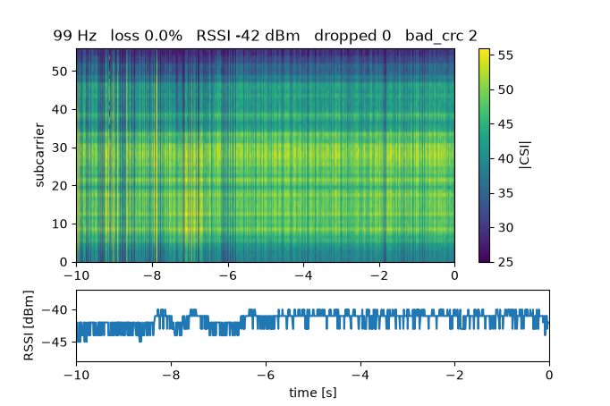
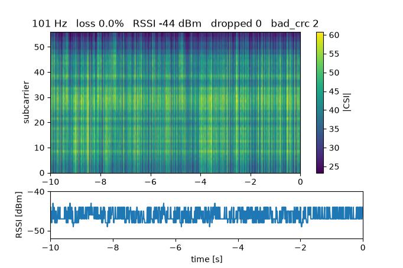

# 4. モニタの読み方 — ヒートマップ・受信レート・欠け・RSSI

[目次](README.md) ・ 前: [3. 書き込みと組ませる](03_flash_and_pair.md) ・ 次: [5. 記録とメタデータ](05_record_and_metadata.md)

この章のゴール: **`uv run csikit monitor` の画面を見て、「ちゃんと測れているか」と「何かが動いたか」を判断できる**こと。
そして、画面の模様が 1 章の CSI（サブキャリアごとの振幅）そのものだと分かること。

用意するもの: 3 章で組ませた送信機（T1）・受信機（R1）。`doctor` が「問題はありません」の状態。
**受信機（R1）だけ USB で PC につながっていれば十分**です。送信機（T1）は USB の充電器など、電源さえあれば動きます。

---

## 4-1. モニタを開く — 「テレビの電波の強さの画面」

🌱 **ファーストタッチ**

テレビのアンテナを向けるとき、設定画面に「受信の強さ」を出しながら向きを変えたことはありませんか。
`csikit monitor` は、そのような**確かめ用の画面**です。記録はせず、今どう受かっているかを 10 秒ぶん流して見せます。

```sh
uv run csikit monitor
```

ウィンドウを閉じれば終わります。決まった時間で閉じて図を保存するなら:

```sh
uv run csikit monitor --duration 12 --save-figure monitor.png
```

🌿 **しくみ** — 画面の 3 つの部分



| 場所 | 何が出ているか | ちゃんと測れているときの目安 |
|---|---|---|
| 上の題名 | `99 Hz`（直近 1 秒に受けた数）・`loss`（欠けの割合）・`RSSI`（受けた強さ）・`dropped`（受信機の中の取りこぼし）・`bad_crc`（壊れて捨てた行の数） | 約 100 Hz・`loss` 数 % 以下・`dropped 0` |
| 真ん中（ヒートマップ） | 横が時間（直近 10 秒）、縦がサブキャリア（56 本）、色が振幅（黄色ほど強い） | 横に縞が続く（何も動いていなければ模様がほぼ変わらない） |
| 下 | RSSI の推移 [dBm] | ほぼ平ら |

- 受信が 2 秒以上止まると、題名が `NO SIGNAL from T1` になります。送信機の電源・距離・組を確かめます（7 章）
- 図の題名・ウィンドウの題名には、**MAC を出しません**。保存した図を人に見せても MAC は漏れません（8 章）
- 受信機の液晶にも同じ数字が出ます（`RX from T1`・受信レート・`loss`・RSSI）。PC が無くても、液晶で受かっているかを確かめられます

🌳 **もう一段** — ヒートマップの 1 列は何？

> この節は、**今は分からなくても先へ進んでかまいません**。

**まず、たとえで全体を見ます。** 1 章で、CSI を「音楽アプリのイコライザーの表示」にたとえました。
ヒートマップは、そのイコライザーの棒の高さを**色**にして、0.01 秒ごとに 1 列ずつ右へ並べたものです。1 列が 1 パケット、1 秒で 100 列です。

**次に、自分の目で確かめます。** 受信機が送ってくる 1 行（1 パケット）を、練習用の値で作って読みます（実機は要りません）。

```sh
uv run python examples/tutorial/csi_line_demo.py
```

```
CSI,5000000,020000000001,1234,-45,-96,11,0,1,0,0,0,0,0,htltf,128,03040 …（16 進が続く）… *c3f0f978
連番 1234・RSSI -45 dBm・チャンネル 11・送信元 02:00:00:00:00:01
使えるサブキャリア 56 本・振幅 5.0（全部同じ値の練習用データ）
```

1 行から、56 本のサブキャリアの振幅が取り出せました。ヒートマップの 1 列は、この 56 個の数を色にしたものです。
練習用の値は全部 3 + 4j なので、振幅は 1 章 1-3 の計算と同じ 5 になります。

**式で書くと:**

- ヒートマップの 1 マス = |H(f)| = √(実部² + 虚部²)（f はそのサブキャリアの周波数）
- 受信レート [Hz] = 直近 1 秒に受けたパケットの数
- 欠けの割合 [%] = 欠け ÷（受けた数 + 欠け）× 100。欠けは連番の飛びから数える（1 章 1-5）

**分かったこと**

- 画面は、1 章の H(f) を時間に沿って並べたもの。数字（Hz・loss）は「ちゃんと測れているか」、模様は「何かが動いたか」を見る

**今は分からなくてよい所:** 色の範囲の決め方（直近の値の 1〜99 % の範囲に合わせている）。サブキャリアの並べ替え（`csikit.io` の `lines_to_capture`）。

---

## 4-2. 手を振ってみる — 「水面に石を投げる」

🌱 **ファーストタッチ**

静かな水面に石を投げると、波紋が広がって水面の模様が変わります。
電波も、部屋の中で人が動くと、跳ね返り方が変わって**ヒートマップの模様が乱れます**。

🌿 **しくみ** — やってみる

1. モニタを開き、10 秒ほど**誰も動かない**で、静かなときの模様を見ます（上の図のような横縞）
2. 送信機と受信機の**間**（2 台を結ぶ線の近く）で、ゆっくり手を振ります
3. 手を止めて、また 10 秒待ちます

見るところ:

- 手を振っている間、ヒートマップの縦の模様（サブキャリアごとの色）が**時間とともに揺れ**ます。止めると、また横縞に戻ります
- RSSI も揺れることがあります。ただ、RSSI は 56 本をまとめた 1 つの数なので、**どのサブキャリアが強まり、どれが弱まったか**は分かりません（1 章 1-2 の「アンテナ表示は全体の強さだけ」）
- **2 台を結ぶ線から離れた所**で手を振ると、変化は小さくなります。どこで動くと映るかは、2 台の置き方で決まります（1 章 1-5）
- PC の上や、受信機のすぐそばで手を動かすと、それだけで大きく変わります。人の動きを測りたいときは、PC と手元が 2 台の間に入らない置き方にします



上の静かなときの図と比べると、横縞が細かく途切れ、縦の縞（時間方向のむら）が増えています。RSSI も細かく上下しています。
違いは目で見て分かりますが、はっきりした差ではありません。数で比べるのは 6 章で行います。
（2 枚は置き方が違います。静かなときの図は 2 台を PC の両脇に置いたもので、RSSI の高さの違いは主に距離のためです）

🌳 **もう一段** — なぜ RSSI より CSI のほうが動きが分かりやすいの？

> この節は、**今は分からなくても先へ進んでかまいません**。

**まず、たとえで全体を見ます。** 合唱の録音を「全体の音量」だけで比べると、1 人が声を変えても気づきにくいですが、
**パートごとの音量**で比べれば、どのパートが変わったか分かります。RSSI が全体の音量、CSI がパートごとの音量です。

**次に、自分の目で確かめます。** 1 章の 1-4 で使った例（人の道の長さを変える）を、もう一度動かします（実機は要りません）。

```sh
uv run python examples/tutorial/multipath_demo.py
```

人の位置が 6 cm 動くと、56 本の振幅の形（どこが山でどこが谷か）が変わります。56 本をまとめた強さ（RSSI にあたる）も変わりますが、
その数 1 つからは、どこが山になりどこが谷になったかは分かりません（この例では、まとめた強さの変化は最大 3.4 dB。形は 56 本それぞれが違う向きに動く）。

**分かったこと**

- 人の動きは、まず「56 本の形の変化」として現れる。だから CSI のヒートマップで見る

**今は分からなくてよい所:** 形の変化を数で表す方法（相関・分散など。6 章の入口で少し使う）。

---

## 4-3. うまく受かっていないとき

🌱 **ファーストタッチ**

スマホの電波が弱いとき、窓際に行ったり、向きを変えたりします。モニタの数字が悪いときも、まず**置き方**を変えます。

🌿 **しくみ**

| 画面 | 考えられること | まずやること |
|---|---|---|
| `NO SIGNAL from T1` | 送信機の電源が切れている・組が違う・遠すぎる | 送信機の液晶が緑の `SENDING` か見る。`doctor` で組を確かめる |
| 受信レートが 100 Hz より大きく下がる・`loss` が数 % を超える | 周りの Wi-Fi が同じチャンネルを使っている・間に金属がある | 2 台を近づける・間の物をどける。それでも多ければ、チャンネルを変える（下） |
| `dropped` が増え続ける | PC が受信機の出す速さについていけていない | 他の重いアプリを閉じる。USB ハブを通さない |
| `bad_crc` が増え続ける | USB の途中で行が壊れている | ケーブルを替える。直接 PC の口につなぐ |

チャンネルによる欠けの違い（2026-10-28 に PC の両脇で 1 分ずつ測った例）: 既定の ch11 は 0.32 %、ch12 は 0.08 %、ch7 は 2.81 %
（[試験の記録](../test-log/2026-10-28-packet-loss-60s-per-channel.md)）。周りの Wi-Fi で変わるので、場所ごとに違います。
チャンネルは `uv run csikit channel <番号>`（1〜13）で、2 台いっしょに変えられます。受信機が署名つきの指示を送信機に無線で伝えます。
M5Stack Basic を再起動すると ch11 に戻ります。

🌳 **もう一段** — 欠け 0.32 % は、どれくらい？

> この節は、**今は分からなくても先へ進んでかまいません**。

**まず、たとえで全体を見ます。** 1000 枚の連番の写真から 3 枚抜けていても、パラパラ漫画として見れば、ほとんど気になりません。
ただし、**続けて何枚も抜ける**と、その間の動きは分かりません。

**次に、自分の目で確かめます。** 1 分（6000 パケット）で欠けが 19 個のとき（ch11 の実測）の割合を計算します。

```sh
uv run python -c "print(19 / (5988 + 19) * 100)"
```

約 `0.32` と出れば正解です。このとき、続けて欠けたのは最長 1 個（0.01 秒）でした。

**分かったこと**

- 欠けの「割合」と「続けて欠けた長さ」の両方を見る。人の動き（0.1 秒以上かかる）を見るなら、0.01〜0.05 秒の穴は問題になりにくい

**今は分からなくてよい所:** 欠けた所を埋める方法（補間）。解析のときに考える。

---

## 確かめよう

1. モニタの題名が `99 Hz  loss 0.3%  dropped 0` のとき、ちゃんと測れている？
2. ヒートマップの縦の 1 列は、何を表している？
3. 手を振ったとき、ヒートマップと RSSI のどちらが、動きについて多くを教えてくれる？　なぜ？
4. `NO SIGNAL from T1` と出た。最初に何を見る？

<details>
<summary>答え</summary>

1. 測れている（約 100 Hz・欠けが少ない・受信機の中の取りこぼしなし）
2. 1 つのパケットの、56 本のサブキャリアの振幅 |H(f)|（色が強さ）
3. ヒートマップのほうが多くを語る。RSSI も変わりうるが、56 本をまとめた 1 つの数なので、どのサブキャリアがどう変わったか（形の変化）は分からないから
4. 送信機の電源と液晶（緑の `SENDING` か）。次に `doctor` で組を確かめる

</details>

## AI に聞いてみよう

- 「ヒートマップとは何か、天気予報の雨雲レーダーのたとえで説明して。横軸・縦軸・色の意味も」
- 「Wi-Fi のパケットロスが 0.3 % と 3 % では、動画通話と、1 秒に 100 回測るセンサーで、それぞれどう違って困る？」
- コマンドライン AI なら: 「`src/csikit/monitor.py` の `MonitorState.title` を開いて、題名の数字をそれぞれどこで計算しているか説明して」

**AI に貼らないもの:** 実機の MAC、周りの Wi-Fi の名前（SSID）。モニタの図は MAC が出ないので貼ってかまいません（部屋の様子が分かる写真は別）。

[目次](README.md) ・ 前: [3. 書き込みと組ませる](03_flash_and_pair.md) ・ 次: [5. 記録とメタデータ](05_record_and_metadata.md)
