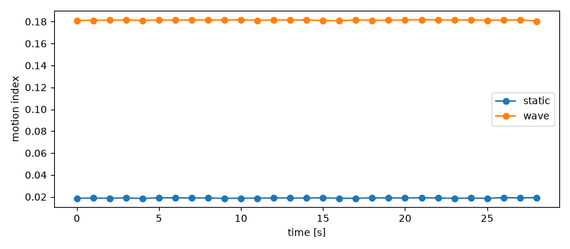
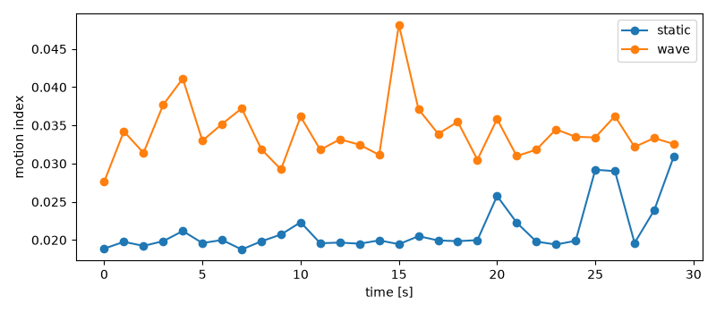

# 6. 解析の入口 — 記録を Python で読み、静かなときと手を振ったときを比べる

[目次](README.md) ・ 前: [5. 記録とメタデータ](05_record_and_metadata.md) ・ 次: [7. 困ったとき・用語集](07_troubleshooting_glossary.md)

この章のゴール: **記録を Python で読み込み、「動きの大きさ」を 1 秒ごとの数にして、静かなときと手を振ったときを比べられる**こと。
そして、その数が 1 章の H(f) の「形の揺れ」を測っていること、1 回の比較から言えること・言えないことが分かること。

実機が無くても、練習用データ（1 章のモデルで作ったもの）で全部の手順を試せます。実機があれば、5 章で取った自分の記録で同じことをします。

> この章は解析の**入口**です。呼吸・在室・行動の推定のような本格的な解析は、このキットの範囲の外です（[要件の「今回の範囲」](../requirements.md)）。

---

## 6-1. 記録を読む — 「表計算のシートを開く」

🌱 **ファーストタッチ**

表計算アプリで CSV のファイルを開くと、行と列の表になります。CSI の記録も、Python で開くと表（配列）になります。
1 行が 1 パケット（0.01 秒）、列が 56 本のサブキャリアです。

🌿 **しくみ**

キットの `csikit.io.load_rx_csv` が、記録を読み、壊れた行を除き、CSI を複素数の表にしてくれます（自分で欄を数える必要はありません）。

```sh
uv run python -c "from csikit import io; cap = io.load_rx_csv('data/raw/<記録の名前>.csv'); print(cap.csi.shape, round(cap.time_sec[-1], 1))"
```

30 秒の記録なら `(3015, 56, 1) 30.2` のように出ます（2026-10-28 の実機の記録の例）。
「3015 パケット × 56 サブキャリア × アンテナ 1 本」と「最後のパケットが始まりから 30.2 秒後」という意味です。

| 名前 | 中身 | 単位 |
|---|---|---|
| `cap.csi` | CSI H(f)（複素数）。パケット × サブキャリア × 1 | — |
| `cap.time_sec` | 各パケットの、記録の始まりからの時刻 | 秒 |
| `cap.seq` | 送信機の連番（欠けを数えるのに使う） | — |
| `cap.rssi_dbm` | 各パケットの RSSI | dBm |

🌳 **もう一段** — 振幅を取り出す

> この節は、**今は分からなくても先へ進んでかまいません**。

**まず、たとえで全体を見ます。** 1 章で、複素数は「矢印」で、矢印の長さが振幅 |H| だと説明しました。
表の全部のマスについて、矢印の長さを測れば、4 章のヒートマップと同じ「振幅の表」になります。

**次に、自分の目で確かめます。** numpy の `np.abs` は、表の全部のマスの矢印の長さを一度に求めます。1 章の 3 + 4j で試します。

```sh
uv run python -c "import numpy as np; print(np.abs(np.array([[3+4j, 6+8j]])))"
```

`[[ 5. 10.]]` と出れば正解です。

**分かったこと**

- 記録 → `load_rx_csv` → `np.abs(cap.csi[:, :, 0])` で、4 章のヒートマップと同じ「時間 × サブキャリア」の振幅の表になる

**今は分からなくてよい所:** 位相（矢印の向き）。ESP32 の位相は、送受の時計のずれで毎回ばらばらになるので、入口では振幅だけを使います。

---

## 6-2. 動きの大きさを数にする — 「手ぶれの大きさ」

🌱 **ファーストタッチ**

スマホで写真を撮るとき、手が震えると写真がぶれます。三脚に置けばぶれません。
「1 秒の間に、画面がどれだけ揺れたか」を数にすれば、手ぶれの大きさを比べられます。

CSI も同じで、**1 秒の間に、56 本の振幅の形がどれだけ揺れたか**を数にします。何も動いていなければ小さく、人が動けば大きくなります。

🌿 **しくみ** — この章での決め方（2 段）

1. **形だけを残す:** 各パケットの 56 本の振幅を、そのパケットの 56 本の平均で割る。こうすると、全体の強さの上がり下がり（RSSI の揺れ）が消え、「どこが山でどこが谷か」だけが残る
2. **揺れを測る:** 1 秒ごとに、各サブキャリアの値が時間とともにどれだけ散らばったか（**標準偏差**）を求め、56 本で平均する

これを **動きの大きさ（motion index）** と呼ぶことにします。研究で決まった唯一の方法ではなく、入口として分かりやすい 1 つの決め方です。

🌳 **もう一段** — 式とコード

> この節は、**今は分からなくても先へ進んでかまいません**。

**まず、たとえで全体を見ます。** クラスの 56 人の身長を毎朝測るとします。一人ひとりの「日ごとの身長の散らばり」を求めて、56 人で平均すれば、
「このクラスの身長は、日によってどれくらい揺れるか」が 1 つの数になります。成長期なら大きく、そうでなければ測り間違いの分だけの小さな数です。

**次に、自分の目で確かめます。** 練習用データ（実機なし）で、静かなときと手を振ったときを比べます。

```sh
uv run python examples/tutorial/compare_motion.py --demo
```

```
static   動きの大きさ（1 秒ごと）: 平均 0.019  最大 0.019  （29 秒分）
wave     動きの大きさ（1 秒ごと）: 平均 0.181  最大 0.182  （29 秒分）
wave の平均は static の 9.6 倍
```

練習用データは、1 章の 3 本の道のモデルに雑音を足して作っています。手を振るときは、人で跳ね返る道の長さが 1 秒に 1 往復、±5 cm 変わる、と**仮定**しています。
雑音の大きさは、実機で取った静かなときの記録（動きの大きさ 平均 0.021）に近くなるようにしました。



**式で書くと:**

- 形: s(t, k) = |H(t, k)| ÷（そのパケットの 56 本の |H| の平均）　（t はパケット、k はサブキャリア）
- 動きの大きさ（1 秒の区切りごと）: M = （1/56）× Σₖ std_t( s(t, k) )　（std_t はその 1 秒の中での標準偏差）

コードは `examples/tutorial/compare_motion.py` の `shape_of` と `motion_index` です。

**分かったこと**

- 「動きの大きさ」は、1 章の「人が動くと形が揺れる」をそのまま数にしたもの。静かなときは雑音の分だけ、動くと何倍にもなる

**今は分からなくてよい所:** 標準偏差の計算の中身。区切りを 1 秒にした理由（短すぎると雑音に振り回され、長すぎると動きの始まりと終わりがぼやける）。

---

## 6-3. 自分の記録で比べる — 「ビフォー・アフター」

🌱 **ファーストタッチ**

スマホの写真アプリの「ビフォー・アフター」のように、同じ場所・同じ置き方で、条件だけを変えた 2 つを並べると、違いが条件のせいだと言いやすくなります。

🌿 **しくみ** — やってみる（実機あり）

1. 2 台を 1〜3 m 離して向かい合わせ、間に物を置かない。PC と自分の手元が、2 台を結ぶ線にかからないようにする。**途中で置き方を変えない**
2. 静かなときを記録する（自分は線から離れた席で、じっとする）

```sh
uv run csikit record --duration 30 --label static --start-delay 10
```

3. 手を振ったときを記録する（Enter の後 10 秒の間に、2 台の真ん中の横へ移動し、線を横切るように**腕全体で大きく**振り続ける。手先だけを小さく振ると差が出にくい。下の結果）

```sh
uv run csikit record --duration 30 --label wave --start-delay 10
```

4. 2 つを比べる（静かなとき・手を振ったときの順に指定）

```sh
uv run python examples/tutorial/compare_motion.py data/raw/<…>-static.csv data/raw/<…>-wave.csv --save motion.png
```

手を振ったときの「動きの大きさ」が、静かなときの何倍になるかが出ます。`motion.png` で、1 秒ごとの変化も見られます。
5 章のとおり、メタデータ（置き方・誰がどこで何をしたか）も書いておきます。

**実機での結果（2026-10-28）。** T1 と R1 を 190 cm 離して向かい合わせ、ch11、各 30 秒。

| 記録 | 動きの大きさ 平均 | 最小〜最大（1 秒ごと） |
|---|---|---|
| 静かなとき | 0.021 | 0.019〜0.031 |
| 手を振ったとき（腕全体で大きく） | 0.034 | 0.028〜0.048 |
| 手を振ったとき（手先で小さく。参考） | 0.028 | 0.023〜0.051 |

大きく振ったときは静かなときの **1.6 倍**で、30 秒のほとんどで 2 本の線が分かれました（下の図）。小さく振ったときは 1.3 倍で、大きな山が 2 回あっただけでした。



練習用データの 9.6 倍よりずっと小さいのは、練習用データが「人で跳ね返る道の長さが ±5 cm 変わる」と**仮定**して作った値だからです。実機の差の大きさは、置き方・距離・振り方で変わります。
静かなときの図の後半（20 秒目以降）に小さな山があります。このとき、2 台から離れた所で犬が動いていました（後で記録した人に聞いて分かったことで、山との対応は確かめていません）。
2 台を結ぶ線から離れていても、部屋の中の動きは少し映ることがあります。記録中に部屋で起きたことは、5 章のメタデータ（`note` の欄）に書いておくと、後で山の原因を探せます。

🌳 **もう一段** — 1 回の比較から、何が言える？

> この節は、**今は分からなくても先へ進んでかまいません**。

**まず、たとえで全体を見ます。** 1 回だけコインを投げて表が出ても、「このコインは表が出やすい」とは言えません。
静かなときと手を振ったときを 1 回ずつ比べて「何倍になった」も、その日・その部屋・その置き方での 1 回の結果です。

**次に、自分の目で確かめます。** 練習用データの乱数の種を変えて、静かなときを 3 回作り直します。

```sh
uv run python -c "import sys; sys.path.insert(0, 'examples/tutorial'); import compare_motion as c; print([round(float(c.motion_index(*c.demo_shape('static', seed=s)).mean()), 4) for s in (0, 2, 4)])"
```

`[0.0189, 0.0189, 0.0188]` のように、ほぼ同じ数が出ます。練習用データは雑音の性質が毎回同じなので、揺れが小さいのです。
**実機ではそうはいきません。** 2026-10-28 に同じ 190 cm の距離で静かなときを 2 回取ると、平均はどちらも 0.021 でしたが、1 秒ごとの最大は 0.057 と 0.031 で、2 倍近く違いました
（1 回目の後に一度置き直しています。1 回目は 1 秒ごとの値が 0.017〜0.057 と 3 倍以上揺れました）。
近くを人が通る、空調の風で物が揺れる、周りの Wi-Fi が混む、などで変わります。

**分かったこと**

- 言えること: その置き方で、手を振ると形の揺れが何倍になったか
- 言えないこと（入口の解析だけでは）: 「誰が」「何をしたか」の区別、別の部屋・別の日でも同じになるか。言うには、条件をそろえて何回も取り、ばらつきと一緒に示す必要がある

**今は分からなくてよい所:** 統計的な検定。何回取れば十分か（研究の目的で変わる。ゼミの先生と相談）。

---

## 6-4. 解析で気をつけること

🌱 **ファーストタッチ**

料理の味見は、同じスプーンで、同じ温度で比べないと、違いが分かりません。CSI の比較も、比べ方をそろえることが一番大事です。

🌿 **しくみ**

| 気をつけること | 理由 |
|---|---|
| 2 つの記録は**同じ置き方・同じチャンネル・同じ出力**で取る | 置き方・チャンネル・出力が変わるだけで、形が変わる（送信機の README: 出力を変えるだけで、人の小さな動きと同じ程度以上に形が変わる） |
| 記録の途中で `csikit channel`・`txpower` を使わない | 同上。変えたら別の記録にする |
| 欠けが多い記録は、まず原因を直す | 欠けた所は時間が飛ぶので、1 秒あたりの数が減る（4 章） |
| メタデータ（置き方・人・区間）を書く | 後から「何を比べたのか」が分からなくなる（5 章） |
| 人の動きを測るときは、相手の同意を取り、倫理の手続きに従う | 1 章 1-6 |
| 記録を人に渡すときは、MAC を伏せた写しにする | `scripts/mask_macs.py`（5 章・8 章） |

---

## 確かめよう

1. `cap.csi.shape` が `(6020, 56, 1)` だった。だいたい何秒の記録？
2. 動きの大きさを求める前に、各パケットの振幅をそのパケットの平均で割るのはなぜ？
3. 静かなときの記録を取った後に、送信機を少し動かしてから手を振ったときの記録を取った。比べてよい？
4. 手を振ったときの動きの大きさが、静かなときの 5 倍になった。「この方法で手の動きが分かる」と言い切れる？

<details>
<summary>答え</summary>

1. 約 60 秒（1 秒に約 100 パケット）
2. 全体の強さの上がり下がり（RSSI の揺れ）を消して、形の揺れだけを見るため
3. 比べないほうがよい。置き方が変わると、手を振らなくても形が変わる。静かなときから取り直す
4. 言い切れない。1 回の結果なので、同じ条件で何回も取り、ばらつきと一緒に示す必要がある

</details>

## AI に聞いてみよう

- 「標準偏差とは何か、テストの点数のばらつきのたとえで説明して。平均との違いも」
- 「Wi-Fi の CSI で人の動きを検出する研究では、どんな特徴量が使われている？　代表的なものを 3 つ、入口向けに」（答えの論文名は、本当にあるかを自分で調べて確かめる）
- コマンドライン AI なら: 「`examples/tutorial/compare_motion.py` の `motion_index` を開いて、区切りを 0.5 秒にしたら結果がどう変わるか、実際に動かして確かめて」

**AI に貼らないもの:** 記録のファイルそのもの（部屋の様子が映りうる）、実機の MAC。貼るなら、`compare_motion.py` が出す数の行だけにする。

[目次](README.md) ・ 前: [5. 記録とメタデータ](05_record_and_metadata.md) ・ 次: [7. 困ったとき・用語集](07_troubleshooting_glossary.md)
